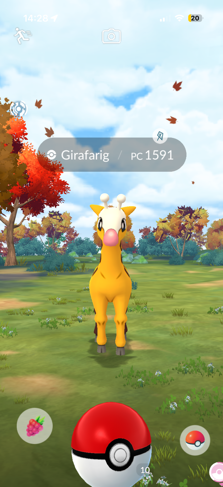
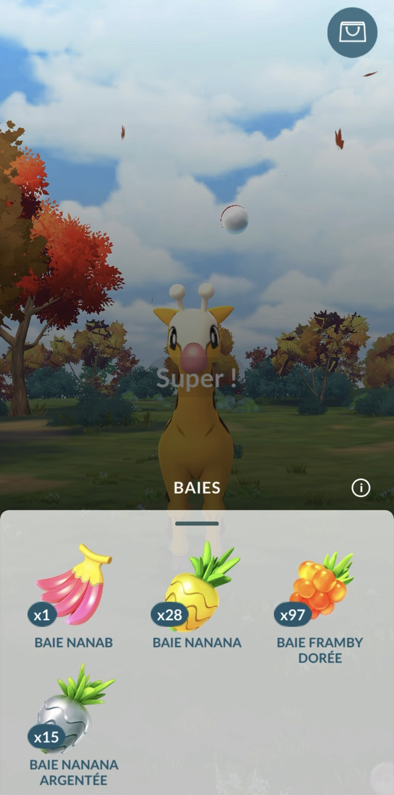

# Fastcatch

## Qu'est-ce que c'est ?
Le fastcatch (capture rapide) consiste à passer les animations lors de la capture d'un pokémon.  

Avantages :
- Gain de temps
- Éviter les animations longues (capture d'un Zorua, Métamorph ou pokémon pas encore dans le pokédex)
- Capturer plus de pokémon lors des évênements limités en durée (heure vedette et community day)

## Comment ?
- Vous devez maintenir le cercle des pokéballs (en bas à droite) ou le cercle des baies (en bas à gauche).
- Tout en gardant un des deux cercles maintenu, vous lancez la pokéball.
- Puis, vous fuyez la capture (icone en haut à gauche).
- Si le pokémon est encore sur la carte, c'est qu'il s'est échappé de la pokéball, vous pouvez donc recommencer les étapes précédentes. Si le pokémon n'est plus sur la carte, vous l'avez bien attrapé ou il s'est enfui.

## Démonstration
### Exemple textuel avec illustrations

- Maintenir un des deux cercles (dans ce cas, le cercle des baies).
:::div{.centre .petite-image}

:::

- Lancer la pokéball en restant appuyer sur le cercle des baies.
:::div{.centre .petite-image}

:::

- Cliquer sur l'écran pour quitter le menu des baies.
- Fuir le combat (icones en haut à gauche).

### Exemple vidéo
À venir...
<!-- <iframe width="100%" height="468" src="./fastcatchDemo.mp4" title="fastcatch demo" frameborder="0" allowfullscreen></iframe> -->
