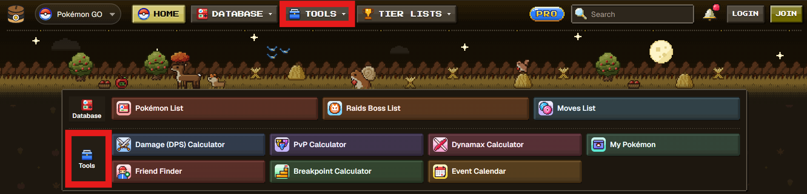
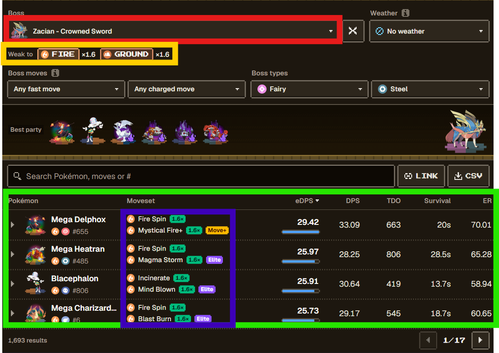

# PokeBase

## À quoi sert Pokebase ?

[Pokebase](https://pokebase.app/pokemon-go) permet de choisir les meilleurs attaquants pour les raids, ainsi que les meilleures équipes pour les dynamax et gigamax.

## Comment l'utiliser ?

- La plupart des fonctionnalités intéréssantes se trouvent dans l'onglet "Tools".
:::div{.centre}

:::

- On y retrouve différents onglets dont :
  - **Damage (DPS) Calculator** : Permettant de choisir un boss et de voir les pokémons lui mettant le plus de dégats par seconde, ainsi que les attaques à lui mettre.
  - **Dynamax Calculator** : Permettant de sélectionner un pokémon dynamax ou gigamax et de voir les meilleurs attaquants, tanks, soigneurs et chargeurs face à lui.

## Damage (DPS) Calculator

- Comme expliqué précédemment, cet outil permet de voir les pokémons mettant le plus de dégats à un boss.
- Sur l'image ci-dessous, on y retrouve les différentes options :
  - En rouge, le boss à sélectionner.
  - En vert, le classement des pokémons lui mettant le plus de dégats par seconde.
- De plus, on y retrouve d'autres informations utiles :
  - En jaune, les types auxquels le boss est faible, ainsi que les multiplicateurs de dégats de ces types.
  - En bleu, l'attaque rapide et l'attaque chargée à mettre à notre pokémon pour qu'il fasse un maximum de dégats.
  - À droite, à coté des attaques, on peut aussi comparer les DPS effectifs (eDPS), permettant de connaitre les différents dégats mis par les pokémons.

:::div{.centre}

:::

## Dynamax Calculator
À venir...